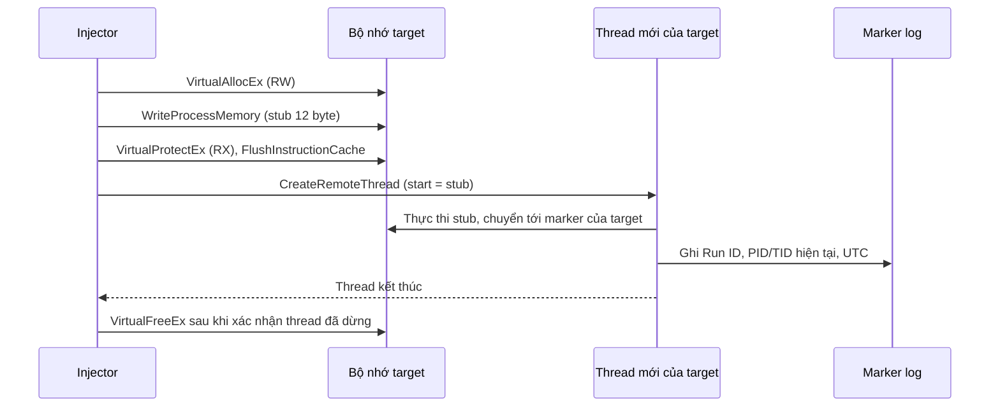
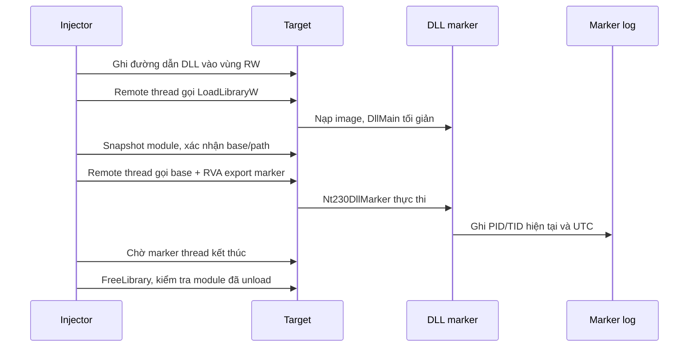
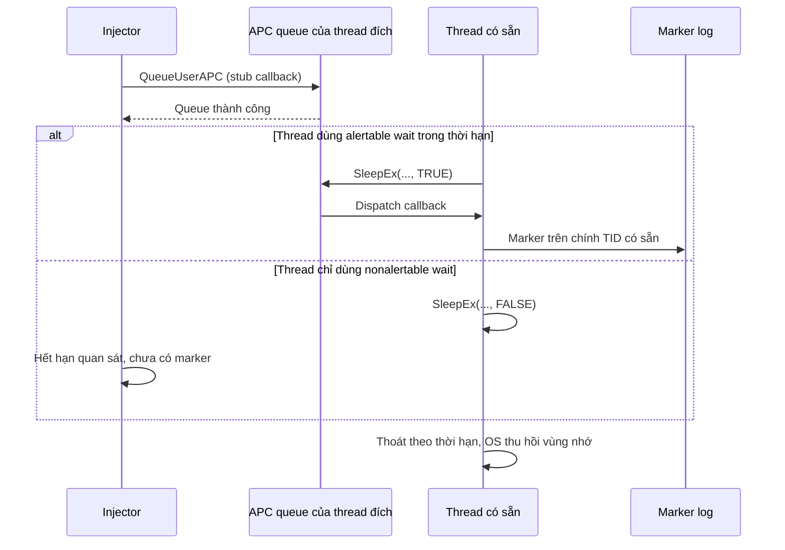

# Báo cáo phần Process Injection — D09

## 1. Mục tiêu và trạng thái

Đề D09 yêu cầu chọn NtCreateThreadEx hoặc section mapping, dùng injector/target tự viết, so sánh CreateRemoteThread và xây dựng detector correlation từ telemetry. Bộ thử nghiệm này chọn NtCreateThreadEx và bổ sung DLL/APC để tạo các hành vi đối chiếu.

**Trạng thái:** đã viết mã và build x64; kiểm tra kỹ thuật host đã qua. Tất cả kết quả thực thi VM, ảnh/video và chỉ số detector đang chờ thu. Các kết quả trong phần kịch bản là **mong đợi**, không phải số đo.

Phạm vi: marker vô hại, target do nhóm kiểm soát, Windows VM có snapshot/rollback. Không dùng payload phá hoại, C2, thu thập thông tin xác thực, exfiltration hoặc persistence. Source không có chức năng che giấu hay vô hiệu hóa bảo vệ.

## 2. Ground truth và cấu hình

Target là `NT230_target.exe`, độc lập với injector. Mỗi lần chạy có Run ID mới, scenario, PID, TID ban đầu và thời hạn. Các địa chỉ marker được target công bố qua named mapping; injector chỉ kết nối đúng binary cùng thư mục. Cơ chế này giữ thử nghiệm trong target của lab và loại bỏ lỗi giả định địa chỉ hệ thống giống nhau giữa hai process.

Marker gọi `GetCurrentProcessId`, `GetCurrentThreadId`, `GetSystemTime` ngay trong context đang thực thi rồi ghi `marker.jsonl`. Vì vậy PID/TID không phải số do injector tự điền. Runner so khớp Run ID, scenario, PID target và TID với thread mới hoặc thread APC có sẵn. Dữ liệu này dùng làm ground truth, không làm feature cho detector. Counter trong shared mapping chỉ đếm callback thread/APC của target, không đếm export của DLL; tổng marker phải lấy từ file marker.

Mẫu log được mô tả bằng schema, không dùng log thành công giả:

```text
utc, tick_ms, run_id, scenario_id, pid, tid, event="marker", kind
```

Mọi pointer được lưu dưới dạng chuỗi hex 64-bit. Thời gian là UTC để ghép sensor; `tick_ms` chỉ có nghĩa so sánh trên cùng máy trong cùng phiên khởi động. Không suy luận thứ tự nhân quả chỉ từ thời gian có độ phân giải millisecond.

Môi trường cần ghi: Windows edition/build, x64, snapshot, phiên bản compiler, SHA256 binary, quyền chạy, sensor/version/config, khoảng quan sát. Win7 và Win11 có bảng kết quả riêng. Bộ mã yêu cầu x64; runner cần PowerShell 5.1.

## 3. CreateRemoteThread Shellcode Injection

### Nguyên lý

Injector cấp phát vùng nhớ trong target, ghi stub mã máy cố định, chuyển RW thành RX rồi tạo remote thread có start address là stub trong target. Stub chỉ chuyển điều khiển tới marker thuộc target. Mã được thực thi trong không gian địa chỉ của target, trên thread mới của target. Đây là sự khác biệt với việc injector tự gọi marker trên thread của chính mình.



### Điều kiện và xác nhận

Injector có quyền mở process, thao tác/ghi/đọc vùng nhớ và tạo thread. Target và stub cùng kiến trúc, địa chỉ callback hợp lệ, calling convention phù hợp. Lab dùng x64 tail jump để giữ nguyên stack/calling convention của ThreadProc.

Thành công cần marker đúng PID target, TID bằng `new_tid`, có log start address và thread đã kết thúc với exit code phù hợp. `CreateRemoteThread` trả handle không tự chứng minh code chạy thành công; Microsoft ghi rõ API có thể trả thành công dù start address không hợp lệ. [CreateRemoteThread](https://learn.microsoft.com/en-us/windows/win32/api/processthreadsapi/nf-processthreadsapi-createremotethread).

### Dấu vết và giới hạn

Quan hệ source–target, quyền process, remote thread và start address ngoài image là tín hiệu quan trọng. Vùng code là private RX sau khi chuyển từ RW; không dùng RWX đồng thời. API trace của injector mô tả bước thử, nhưng detector cần sensor độc lập để xác nhận vùng nhớ hoặc chuỗi API; Sysmon không ghi đầy đủ mọi thao tác VirtualAllocEx/WriteProcessMemory/VirtualProtectEx.

Lỗi có thể do access denied, x86/x64, địa chỉ/ABI sai, chính sách bảo vệ vùng executable hoặc target kết thúc sớm. Timeout không cho phép giải phóng code vẫn có thể được thread sử dụng. Lab giữ vùng nhớ tới lúc target thoát nếu chưa xác nhận kết thúc; không TerminateThread.

## 4. DLL Injection

### Nguyên lý

Injector ghi đường dẫn DLL marker cố định vào target, tạo remote thread gọi LoadLibraryW tại địa chỉ do target cung cấp. Sau khi loader thread kết thúc, injector kiểm tra module trong target rồi gọi export `Nt230DllMarker` bằng thread thử nghiệm riêng. DllMain chỉ trả TRUE.



### Điều kiện và xác nhận

DLL đúng x64, đường dẫn tồn tại trong guest, dependencies đầy đủ, target cho phép nạp DLL. Injector lấy module base bằng Toolhelp snapshot; không dùng DWORD exit code của thread làm HMODULE 64-bit. RVA export được lấy từ đúng DLL cùng đường dẫn, nạp cục bộ chỉ để resolve symbol; injector không gọi marker export cục bộ.

Ba trạng thái được giữ riêng: **module đã nạp**, **marker export đã chạy trong target**, **detector đã quyết định**. Marker được gọi riêng sau LoadLibrary để tránh công việc phức tạp trong DllMain khi loader lock đang giữ. Đây là biến thể DLL injection có bước marker riêng; không tuyên bố marker chạy ngay từ DllMain. [LoadLibraryW](https://learn.microsoft.com/en-us/windows/win32/api/libloaderapi/nf-libloaderapi-loadlibraryw), [DLL best practices](https://learn.microsoft.com/en-us/windows/win32/dlls/dynamic-link-library-best-practices).

Ca benign B02 dùng target tự LoadLibrary/call export/FreeLibrary. Module load xuất hiện ở cả B02 và P02; nguồn tạo remote thread và quan hệ source–target giúp phân biệt. Chỉ cảnh báo mọi lần nạp DLL sẽ gây false positive.

### Dấu vết và giới hạn

Có thể quan sát ImageLoad, process access và remote thread. P02 dùng ba thread thử nghiệm: LoadLibrary, marker export và FreeLibrary. Khi báo cáo thread count phải tính cả các bước này. Marker TID phải khớp thread của phase `Nt230DllMarker`.

Module load không tự chứng minh marker export đã chạy. Export thiếu, dependency lỗi, kiến trúc sai hoặc module snapshot thất bại phải được ghi riêng. Nếu marker thread chưa kết thúc thì không unload DLL đang thực thi. DLL còn nạp sau lỗi được OS thu hồi khi target kết thúc; phải ghi cleanup chưa hoàn tất trước đó.

## 5. APC Queue Code Injection

### Nguyên lý

Injector ghi stub trong private RX và queue callback lên **thread có sẵn** của target. Với user-mode APC thông thường trên thread đang chạy, callback được phân phối khi thread vào alertable wait. Target điều khiển điều kiện này bằng `SleepEx(25, TRUE/FALSE)`.



### Điều kiện và xác nhận

Cần handle thread có `THREAD_SET_CONTEXT`, callback/target cùng kiến trúc, thread còn sống và có cơ hội alertable wait. Microsoft lưu ý các vấn đề khi queue APC giữa process; lab thu hẹp bằng target hợp tác x64 và callback hợp lệ. [QueueUserAPC](https://learn.microsoft.com/en-us/windows/win32/api/processthreadsapi/nf-processthreadsapi-queueuserapc).

P03 dùng alertable; P04 giữ nonalertable trong toàn bộ thời gian sống của target. Log ghi riêng `apc_queue.queued` và `apc_observation.marker_counter_changed`. Counter chỉ hỗ trợ tiến trình thử nghiệm; kết luận thực thi vẫn dựa vào marker log. TID marker phải bằng TID ban đầu của target; không có remote thread mới cho bước APC.

P04 mong đợi queue thành công nhưng chưa có marker. Đây là một **injection attempt chưa quan sát được execution**, không phải lỗi QueueUserAPC và không phải benign. B03 là ca benign target tự queue callback hợp lệ trên chính mình.

### Dấu vết và giới hạn

Remote memory, thread access và thao tác queue có ích nếu sensor hỗ trợ. Không dựa vào Event ID 8 để kết luận mọi APC: phương pháp này không tạo thread mới. Sysmon không có sự kiện QueueUserAPC chuyên biệt; muốn phát hiện chính xác cần telemetry bổ sung/API instrumentation được thiết kế độc lập. Thiếu sensor phải ghi thiếu coverage.

Timeout không hủy APC. Marker đã ghi cũng không bảo đảm callback đã return. Lab không free stub sau queue thành công; OS thu hồi khi target thoát. Không chuyển một thread nonalertable sang alertable chỉ để làm ca P04 trông như thành công.

## 6. Tại sao NT API quan trọng, và chọn gì?

**Đây là điều kiện nội dung của D09.** Chỉ làm CreateRemoteThread, DLL và APC vẫn thiếu lựa chọn NtCreateThreadEx/section mapping ghi ở D13. Trong rubric, detector chiếm 4/10 điểm; nhóm cũng không nên coi việc có injector là hoàn tất đồ án.

NtCreateThreadEx là entry point Native API trong ntdll. Bộ lab resolve export bình thường rồi gọi với flags=0; nhận NTSTATUS và handle thread. Không dùng direct syscall, syscall number, unhook hay cờ che giấu. Khai báo tham chiếu header phnt của dự án System Informer; đây là tài liệu dự án, không phải cam kết API Win32 ổn định của Microsoft. [phnt ntpsapi.h](https://github.com/winsiderss/phnt/blob/master/ntpsapi.h).

| Điểm so sánh | CreateRemoteThread — P01 | NtCreateThreadEx — P05 |
|---|---|---|
| Lớp API | Win32 | Native API, resolve export ntdll |
| Kết quả API | Handle; GetLastError khi lỗi | NTSTATUS và handle; đánh giá NT_SUCCESS theo status không âm |
| Code/target | Stub 12 byte, target x64 của lab | Cùng stub và loại target |
| Bộ nhớ/quyền process | RW rồi RX, cùng mask trong lab | Giữ nguyên để kiểm soát biến |
| Thread | Thread mới, start private RX | Thread mới, start private RX |
| Điều cần đo | Marker, TID, địa chỉ, lỗi, cleanup, sensor event | Cùng tiêu chí, thêm NTSTATUS |
| Kết luận detector | Dựa vào event thực đo | Không mặc định bỏ qua được sensor chỉ vì dùng NT API |

P06 gọi NtCreateThreadEx trực tiếp tại marker trong image của target. So sánh P05–P06 thay đổi backing/start address: private RX sau ghi remote code so với code đã có trong image, không có cấp phát code mới. Đây là biến thể **remote execution tại code có sẵn**, không phải shellcode injection. Nó kiểm tra giới hạn của rule chỉ tìm thread bắt đầu ngoài image.

Section mapping là lựa chọn thay thế trong đề: chia sẻ/map một section vào các process thay cho đường cấp phát/ghi riêng. Không cần triển khai cả hai lựa chọn để đạt yêu cầu tối thiểu; báo cáo này chọn NtCreateThreadEx để có phép so sánh trực tiếp và ít thay đổi giữa các ca.

Sản phẩm cần giao cho người làm detector: cặp P01/P05 trên mỗi OS với cùng compiler/marker, P06 kiểm tra start address, EVTX/ETW gốc, trạng thái marker, NTSTATUS/Win32 error, access mask, duration và cleanup. Thời gian gọi API từ một lần chạy không đủ kết luận hiệu năng; cần lặp lại và báo phân bố nếu đánh giá latency.

## 7. Bảng so sánh ba phương pháp

| Tiêu chí | CreateRemoteThread stub | DLL Injection | APC Queue |
|---|---|---|---|
| Nơi code bắt đầu | Vùng private RX mới | LoadLibrary trong module hệ thống; sau đó export DLL | Stub private RX trên thread sẵn có |
| Thread mới | Có | Có, ba phase trong lab | Không cho bước APC |
| Điều kiện riêng | Start address/ABI hợp lệ | DLL/path/exports/dependencies hợp lệ | Thread vào alertable wait |
| Bằng chứng thực thi | Marker PID target + new TID | Module loaded và marker export đúng PID/TID | Marker PID target + existing TID |
| Đối chứng | B01: target không injector | B02: self-load/call export | B03: self-queue APC |
| Thành công API chưa đủ vì | Thread có thể fault | Module load khác marker export chạy | Queue khác callback dispatch |
| Sensor nên xem | Source-target, access, remote thread, memory backing | Source-target, remote thread, ImageLoad | Thread access/queue và memory; không bắt buộc new thread |
| Cleanup | Free sau thread termination | Free path, chờ marker, unload DLL | Giữ code tới target exit |

## 8. Detector và đánh giá

Detector không đọc marker, counter hoặc thông báo thành công của injector để quyết định. Input chính là telemetry; Run ID/window/PID chỉ dùng ghép nhãn đánh giá. Trong triển khai thật nên ưu tiên ProcessGuid, thời gian tạo process và correlation window để tránh PID reuse. Không xây rule theo tên scenario hoặc duy nhất tên `NT230_injector.exe` rồi coi đó là phát hiện tổng quát.

Sysmon Event 7 quan sát image load, Event 8 cung cấp source/target và thông tin start address, Event 10 quan sát process access. Event 7 cần được bật; khả năng quan sát từng phương pháp phải xác minh bằng dữ liệu. Các thông tin module/function ở Event 8 có thể được suy ra hoặc để trống, không phải ground truth hoàn hảo. [Sysmon](https://learn.microsoft.com/en-us/sysinternals/downloads/sysmon).

Endpoint của evaluator là **injection attempt detection**. Positive gồm P01–P06, kể cả P04 chưa có execution. Negative gồm B01–B03. Lưu marker outcome ở cột riêng. Không đổi endpoint giữa các phương pháp để làm đẹp chỉ số.

- Precision = TP / (TP + FP).
- Recall = TP / (TP + FN).
- F1 = 2TP / (2TP + FP + FN).
- FPR = FP / (FP + TN).

Ca lỗi thực nghiệm hoặc detector chưa đánh giá được loại khỏi mẫu số và liệt kê riêng. Mẫu số bằng 0 là chưa xác định. Báo cả số ca bị loại và evaluated fraction để tránh chỉ trình bày các ca dễ phát hiện. Các lần chạy từ cùng binary/scenario có tương quan; bộ mẫu nhỏ này không chứng minh hiệu quả trên mọi phần mềm thực tế.

## 9. Kết quả cần điền sau khi chạy VM

| OS/sensor | Run ID | Scenario | API/queue | Marker PID/TID | Module/start address | Cleanup | Detector | Evidence |
|---|---|---|---|---|---|---|---|---|
| Chưa đo | — | — | — | — | — | — | Chưa đánh giá | Chờ chạy VM |

Đính kèm `results.csv` gốc, các thư mục Run ID, cấu hình sensor, EVTX/ETW, ảnh/video. Phân tích riêng access denied, missing dependency, queue không dispatch, timeout, target exit và thiếu telemetry. Kết quả build trong `verification/` không thay thế bảng này.
