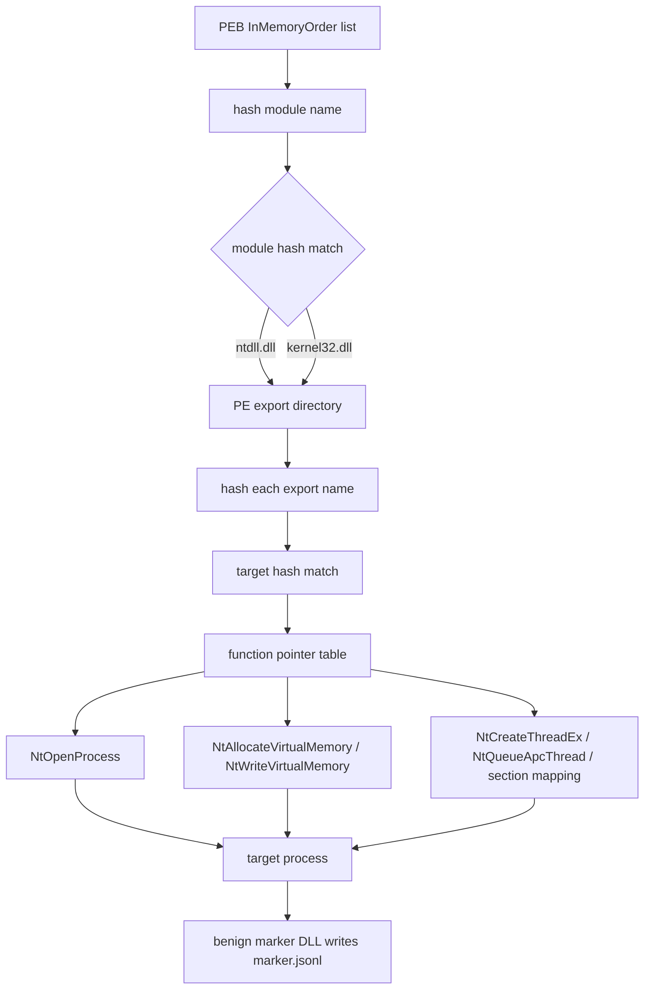

# FootlessLoader — API hashing + NT API process injection lab

<br/>

> [!WARNING]
> This project is for authorized security testing, research, and education
> only, inside an isolated Windows VM with a snapshot. It does not contain a
> destructive payload, C2 channel, credential theft, persistence, or
> exfiltration. Unauthorized use against systems you do not own is illegal.
> See [SAFETY.md](../SAFETY.md) and [docs/RUNBOOK.md](docs/RUNBOOK.md) / [docs/DEMO.md](docs/DEMO.md).

<br/>

This repository is the **PoC side** of the D08 + D09 assignment. The
independently written **detector** lives in
[`../Footless-detector`](../Footless-detector/README.md). The two projects
share only the telemetry schema; the detector never imports loader code and
the loader never calls detector code.

## 1. What is implemented

| Requirement | Implementation |
|---|---|
| Dynamic API resolution / API hashing | PEB module walk + PE export-table walk; compile-time hash table; three hash algorithms and a second seed build |
| NT API usage | `NtOpenProcess`, `NtAllocateVirtualMemory`, `NtWriteVirtualMemory`, `NtProtectVirtualMemory`, `NtCreateThreadEx`, `NtQueueApcThread`, `NtCreateSection`, `NtMapViewOfSection`, `NtUnmapViewOfSection`, `NtClose`, `NtQuerySystemInformation`, `NtQueryInformationProcess` |
| Process injection | `crt`, `nt`, `stub`, `apc`, `section` methods; all end in a benign marker DLL |
| Benign controls | sleeping target, target self-load, ordinary console application |
| Variants | three hash functions, alternate seed, quiet build with API labels removed |
| Evidence | `loader.jsonl` (detector input) and `marker.jsonl` (ground truth), build log and SHA256 |

## 2. Architecture



Text fallback:

```text
PEB -> module hash -> export table -> export hash -> function pointer
    -> open/allocate/write/protect/thread/section -> benign marker
```

The sensitive API names are **not** stored in the binary. `tools/gen_api_hashes.py`
pre-computes every `(module, API, variant, seed)` tuple into
`src/api_hashes.h` at build time. The loader only carries module names
(`ntdll.dll`, `kernel32.dll`) and hash constants. The `_quiet` build also
redacts API labels from telemetry, so the detector cannot rely on strings.

## 3. Layout

```text
Footless-loader/
├── build.sh, build.ps1          cross-build + Windows build
├── src/
│   ├── hash.c/.h                three hash variants + wide module hash
│   ├── resolver.c/.h            PEB walk, PE export walk, hash lookup
│   ├── ntapi.c/.h               API table resolved by hash
│   ├── inject.c/.h              crt / nt / stub / apc / section methods
│   ├── log.c/.h                 JSONL telemetry and marker writer
│   ├── main.c                   CLI: selftest / resolve / find / inject
│   ├── target.c                 benign sleeping target
│   ├── marker.c                 benign marker DLL
│   ├── benign.c                 ordinary control application
│   └── api_hashes.h             generated, not hand-edited
├── tools/gen_api_hashes.py      build-time hash generator
├── scripts/                     VM runner, Sysmon collector, marker verifier
├── telemetry/sysmon-footless.xml
├── docs/                        design, runbook, variants, evidence
├── test-case.md                 test plan mapped to CLI commands
├── dist/                        build artifacts (gitignored)
└── InjectionLab/                earlier reference lab, kept for comparison
```

## 4. Build

### Windows + MinGW-w64 x64

```powershell
cd Footless-loader
.\build.ps1
```

### Linux/WSL cross-build (used for the submitted artifacts)

```sh
sudo apt install gcc-mingw-w64-x86-64   # or use an existing toolchain
cd Footless-loader
CC=x86_64-w64-mingw32-gcc ./build.sh
```

Outputs under `dist/`:

| File | Purpose |
|---|---|
| `footless_loader.exe` | baseline build (FNV-1a API hash) |
| `footless_loader_seeded.exe` | rotate/xor/add variant |
| `footless_loader_module_api.exe` | `module:api` variant, different key order |
| `footless_loader_quiet.exe` | baseline with API labels removed from strings and log |
| `footless_loader_seed_alt.exe` | alternate seed (`0xdeadbeef`) |
| `footless_target.exe` | benign target; prints READY PID/TID |
| `footless_marker.dll` | benign marker DLL |
| `benign_app.exe` | negative control with ordinary imports |
| `build.log`, `sha256.txt` | reproducible build evidence |

The build does not execute any binary. Verify the artifacts without
running them:

```sh
python3 tools/verify_build.py
```

It checks SHA256, generated hash drift, absence of sensitive API strings in
the quiet build, empty sensitive IATs, the marker export, and runs the
independent detector over every loader variant (alert) and benign control
(clean). Output: `dist/verification.json`.

## 5. Commands

```text
footless_loader.exe selftest [--variant baseline|seeded|module-api|all] [--seed S]
footless_loader.exe resolve MODULE API [--variant V] [--seed S]
footless_loader.exe find --name footless_target.exe
footless_loader.exe inject --pid N | --name IMAGE [options]
```

`inject` options:

```text
--method crt|nt|stub|apc|section   (default crt)
--tid N                            APC target thread (auto: first target thread)
--dll footless_marker.dll          only this DLL basename is accepted
--timeout MS                       100..60000
--run ID  --scenario ID  --log loader.jsonl
--variant baseline|seeded|module-api   (resolver self-test / API table)
--seed S
```

Injection is gated:

```powershell
$env:FOOTLESS_LAB_CONFIRM = '1'
$env:FOOTLESS_VM_SNAPSHOT = 'Win11-before-Footless'
```

The loader also refuses targets outside `footless_target.exe` / `notepad.exe`
and marker DLLs outside `footless_marker.dll`. These are lab safety rails,
not a security boundary.

## 6. Injection methods

| Method | Primitive | Remote memory | Thread | Detector signal |
|---|---|---|---|---|
| `crt` | `CreateRemoteThread(LoadLibraryW, path)` | path buffer RW | new thread | source→target, remote thread, load |
| `nt` | `NtCreateThreadEx(LoadLibraryW, path)` | path buffer RW | new thread | same, native API status |
| `stub` | fixed 24-byte x64 stub calls `LoadLibraryW` | RW → RX | new thread (`CreateRemoteThread`) | RW→RX transition, graph |
| `apc` | same stub queued with `NtQueueApcThread` | RW → RX | existing thread | no new thread; memory + queue |
| `section` | pagefile section mapped into target | section-backed RW → RX | `NtCreateThreadEx` | image-independent RX section |

The stub is built from constants and a function address; it is not
attacker-supplied shellcode. The only executable content is a call to
`LoadLibraryW` with the lab marker path.

## 7. Evidence contract

`loader.jsonl` example:

```json
{"utc":"2026-11-13T01:00:00.002Z","tick_ms":102,"run_id":"P03","scenario_id":"stub","pid":4210,"tid":4211,"event":"memory_protect","operation":"protect_memory","base_address":"0x1f1000","size":24,"memory_protection":"RX","ntstatus":"0x00000000"}
```

- `source_target` / `process_open`: process relation.
- `memory_allocate` / `memory_write` / `memory_protect` / `memory_map`: remote memory.
- `remote_thread`: new thread with `new_tid` and `start_address`.
- `apc_queue`: queue attempt on an existing TID.
- `error` / `result`: stage and exit code.

`marker.jsonl` is written by the DLL in the **target** and records the real
PID/TID/image. It is ground truth for the runbook and must not be fed to the
detector. See [docs/EVIDENCE.md](docs/EVIDENCE.md).

## 8. Runbook summary

```powershell
# 1. In the VM, after creating a snapshot:
$env:FOOTLESS_VM_SNAPSHOT = 'Win11-before-Footless'
.\scripts\run_lab.ps1 -SnapshotName $env:FOOTLESS_VM_SNAPSHOT `
    -VmSnapshotConfirmed -Method stub -Scenario P03

# 2. Collect Sysmon for the same window (sensor configured beforehand):
.\scripts\collect_sysmon.ps1 -RunDirectory .\evidence\<suite>\<run>

# 3. Verify the marker came from the target process:
python3 .\scripts\verify_marker.py --run-dir .\evidence\<suite>\<run>

# 4. Analyze the telemetry with the independent detector:
cd ..\Footless-detector
python main.py ..\Footless-loader\evidence\<suite>\<run>\telemetry.jsonl
```

Full VM and sensor steps: [docs/RUNBOOK.md](docs/RUNBOOK.md) và [docs/DEMO.md](docs/DEMO.md).

## 9. Variants and trade-offs

[docs/VARIANTS.md](docs/VARIANTS.md) contains the scenario matrix. Summary:

| Change | Detector effect |
|---|---|
| FNV-1a → rotate/xor/add | static hash-loop and constant features remain; IAT unchanged |
| API key → `module:api` | hash values change, same structural signals |
| seed change | constants change; `hash_loop` still fires on the loop shape |
| quiet build | API strings disappear; static PEB + loop + IAT-gap features still detect; runtime uses behaviour, not strings |
| CRT → NtCreateThreadEx | same observable source→target + new thread; detector must not key on Win32 API name |
| stub → section | no private RW allocation; detector uses RX section + graph + memory write |
| APC | no new thread; detector needs memory + queue/access features |

## 10. Limits

- The binary was cross-compiled and statically verified on Linux; the
  submitted artifacts are not a claim of VM execution. Run the runbook in
  the VM and replace the synthetic telemetry in the detector dataset with
  real captures.
- `LoadLibraryW`'s address is taken from the loader's kernel32. Windows
  system DLLs are normally mapped at the same base in same-boot x64
  processes; a hardened/forced-ASLR configuration can break this. The loader
  checks the target is not WOW64.
- The marker DLL writes during `DllMain`; this is convenient for a lab but
  not a production pattern (loader lock).
- `section` maps a pagefile-backed section; it is not a full manual PE
  mapping. It is enough to exercise the D09 section-mapping choice.
- The target/safety rails restrict names deliberately; this is not malware
  and cannot target arbitrary processes by design.
- No anti-analysis, unhooking, syscall-number resolution, or defense
  evasion is implemented. The project measures the observability trade-off,
  not bypass capability.

## 11. Rubric map

| Rubric | Where |
|---|---|
| A. Mechanism + PoC | `docs/DESIGN.md`, `src/*.c`, `selftest`, `dist/build.log`, `test-case.md` |
| B. Variants + controls | `docs/VARIANTS.md`, five loader builds, `benign_app.exe`, target self-load, detector ablation |
| C. Detector | `../Footless-detector` (independent, static/runtime/memory/graph) |
| D. Evaluation + safety | `../Footless-detector/reports/`, `docs/RUNBOOK.md`, `../SAFETY.md` |
