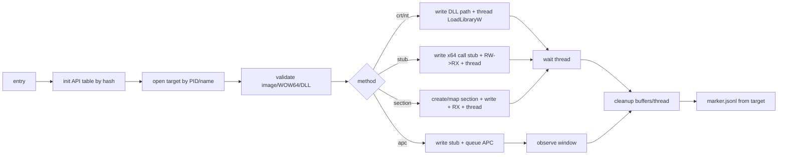
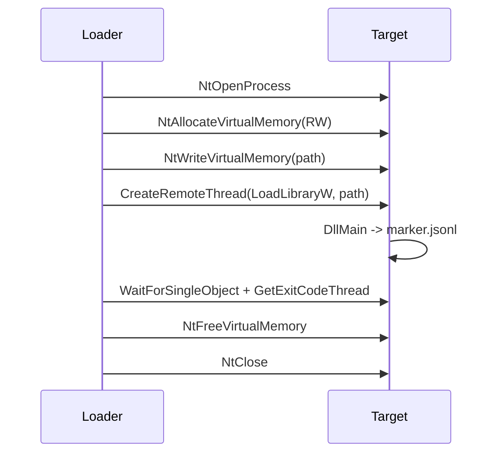
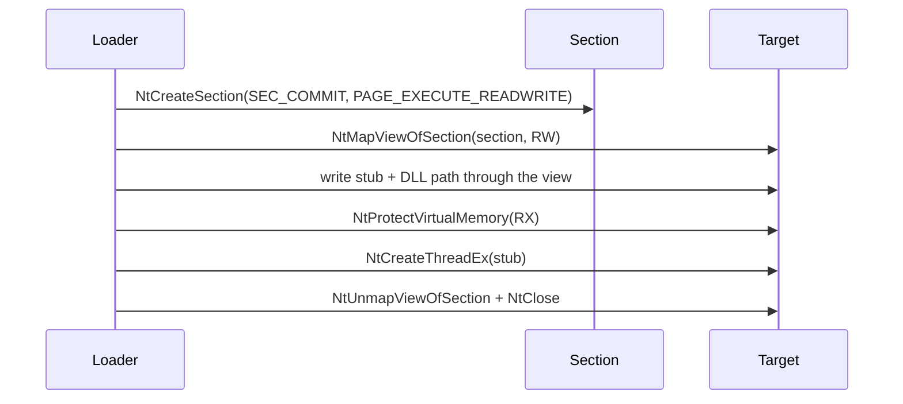

# Thiết kế kỹ thuật — FootlessLoader

Tài liệu này giải thích **cơ chế, luồng thực thi, điều kiện và giới hạn** của
PoC. Nó là phần minh chứng cho hạng mục A (3 điểm); mã nguồn tương ứng nằm
trong `src/`.

## 1. Phạm vi và threat model

- Mục tiêu là một **loader lab** chạy trong Windows x64 VM có snapshot.
- Payload duy nhất là `footless_marker.dll` vô hại, ghi PID/TID/image vào
  `marker.jsonl`.
- Không có C2, credential theft, persistence, exfiltration, shellcode tùy ý,
  hay vô hiệu hóa bảo vệ.
- Loader từ chối target ngoài `footless_target.exe` / `notepad.exe` và DLL
  ngoài `footless_marker.dll`; đây là safety rail của lab, không phải ranh
  giới bảo mật.
- Detector là dự án độc lập, chỉ đọc PE/telemetry; nó không import loader.

## 2. Luồng tổng quát



Thứ tự thực tế trong `footless_inject`:

1. `NtOpenProcess` với mask tối thiểu cần thiết.
2. `QueryFullProcessImageNameW` + allowlist + `IsWow64Process`.
3. Kiểm tra DLL tồn tại và đúng basename.
4. Ghi `source_target` vào `loader.jsonl`.
5. Chạy method.
6. Ghi `result`, đóng handle.

## 3. Resolver

### 3.1 Tìm module bằng PEB

Không dùng `GetModuleHandle`/`LoadLibrary` cho API nhạy cảm. Resolver đọc
PEB từ `gs:[0x60]`, đi theo `InMemoryOrderModuleList`:

```text
PEB
 └─ Ldr (PEB_LDR_DATA)
     └─ InMemoryOrderModuleList
         └─ LDR_DATA_TABLE_ENTRY
             ├─ DllBase
             └─ BaseDllName
```

`FOOTLESS_LDR_ENTRY` trong `src/resolver.h` khai báo đầy đủ layout x64:
`InLoadOrderLinks`, `InMemoryOrderLinks`, `InInitializationOrderLinks`,
`DllBase`, `EntryPoint`, `SizeOfImage`, `FullDllName`, `BaseDllName`.
Danh sách được giới hạn 4096 entry để tránh vòng lặp hỏng.

Module name được băm bằng FNV-1a trên **wide name lower-case**; hash này độc
lập với variant của API key. Chỉ `ntdll.dll` và `kernel32.dll` được tìm.

### 3.2 Export table

Với `DllBase`:

1. Kiểm tra `IMAGE_DOS_HEADER` và `e_lfanew`.
2. Kiểm tra `IMAGE_NT_HEADERS` + `PE32+` magic.
3. Lấy `DataDirectory[IMAGE_DIRECTORY_ENTRY_EXPORT]`.
4. Duyệt `AddressOfNames`, đọc tên có giới hạn trong `SizeOfImage`.
5. Băm tên export, so với hash đích.
6. Lấy ordinal → `AddressOfFunctions` → RVA.
7. Từ chối forwarder (RVA nằm trong export directory) và RVA ngoài image.

Mọi truy cập đều có kiểm tra biên (`rva_span`, `bounded_export_string`).

### 3.3 Ba hàm băm

| Variant | Công thức | Đặc điểm |
|---|---|---|
| `baseline` | FNV-1a 32-bit: `state = 0x811c9dc5 ^ seed; state = (state ^ byte) * 0x01000193` | nhanh, hằng số FNV nổi tiếng |
| `seeded` | `state = 0xa5a5a5a5 ^ seed; state = rol5(state) ^ byte + 0x9e3779b9` | đổi thứ tự rotate/xor/add |
| `module-api` | như `seeded` nhưng băm `module + ':' + api` | khóa phụ thuộc module, đổi thứ tự |

`--seed` đổi hằng số khởi tạo; build `_seed_alt` dùng `0xdeadbeef`.

### 3.4 Bảng hash biên dịch

`tools/gen_api_hashes.py` sinh `src/api_hashes.h`:

```c
#define FOOTLESS_GENERATED_SEED 0x13579bdf
static const uint32_t footless_generated_api_hash[27][3] = { ... };
```

`footless_init_api_table` chỉ dùng bảng này + tên module. Vì vậy chuỗi
`NtOpenProcess`, `NtCreateThreadEx`, ... không còn trong binary. Bản
`_quiet` còn loại bỏ chúng khỏi log.

`--variant`/`--seed` ở CLI vẫn dùng được cho lệnh `selftest`/`resolve`
(vốn nhận tên API từ dòng lệnh), nhưng bảng inject dùng seed lúc build.

## 4. API table

`FOOTLESS_API_TABLE` chứa 27 function pointer:

- ntdll: `RtlGetVersion`, `NtClose`, `NtOpenProcess`,
  `NtAllocateVirtualMemory`, `NtWriteVirtualMemory`, `NtReadVirtualMemory`,
  `NtProtectVirtualMemory`, `NtFreeVirtualMemory`, `NtCreateThreadEx`,
  `NtOpenThread`, `NtQueueApcThread`, `NtQuerySystemInformation`,
  `NtCreateSection`, `NtMapViewOfSection`, `NtUnmapViewOfSection`,
  `NtWaitForSingleObject`, `NtQueryInformationProcess`.
- kernel32: `LoadLibraryW`, `CreateRemoteThread`,
  `QueryFullProcessImageNameW`, `IsWow64Process`, `GetExitCodeThread`,
  `CloseHandle`, `WaitForSingleObject`, `FlushInstructionCache`, `Sleep`,
  `GetThreadId`.

Nếu một export không resolve được, table bị xóa và loader dừng trước khi
mở process.

## 5. Các phương thức injection

### 5.1 `crt`



Điều kiện: kernel32 của loader và target cùng base (chuẩn trên Windows
same-boot x64), target không phải WOW64, DLL phụ thuộc đầy đủ.

### 5.2 `nt`

Giống `crt` nhưng gọi `NtCreateThreadEx`:

```c
NtCreateThreadEx(&thread,
    THREAD_QUERY_INFORMATION | SYNCHRONIZE,
    NULL, process, start, argument, 0, 0, 0, 0, NULL);
```

So sánh trực tiếp với `crt`: cùng start address/arg, khác lớp API và kiểu
trả về (NTSTATUS thay vì Win32 error). Detector phải dựa vào quan hệ
source→target + new thread, không dựa vào tên API Win32.

### 5.3 `stub`

Stub 24 byte, không phải shellcode tùy ý:

```asm
48 B8 <imm64>        mov rax, LoadLibraryW
48 B9 <imm64>        mov rcx, remote_path
48 83 EC 28          sub rsp, 0x28
FF D0                call rax
48 83 C4 28          add rsp, 0x28
C3                   ret
```

- `sub rsp, 0x28` căn stack 16-byte và cấp shadow space cho ABI x64.
- Stub chỉ gọi `LoadLibraryW` với đường dẫn marker.
- Bộ nhớ: RW → `NtProtectVirtualMemory(PAGE_EXECUTE_READ)`.
- Không dùng RWX đồng thời.

### 5.4 `apc`

Cùng stub, nhưng:

1. `NtOpenThread` với `THREAD_SET_CONTEXT`.
2. `NtQueueApcThread(thread, stub, NULL, NULL, NULL)`.
3. Chờ trong cửa sổ `--timeout`; target phải ở alertable wait
   (`SleepEx(25, TRUE)`).

Queue thành công **không** chứng minh callback đã chạy. `marker.jsonl` là
ground truth; nếu không thấy marker, loader trả trạng thái attempt (20) và
detector vẫn phải coi đây là injection attempt.

### 5.5 `section`



Đây là lựa chọn "section mapping" của D09. Vùng nhớ là pagefile-backed,
không phải private allocation; detector thấy `memory_backing: pagefile_section`.

## 6. Target và marker

`footless_target.exe`:

- In `READY run=... pid=... tid=...`.
- Đặt `FOOTLESS_MARKER_LOG`, `FOOTLESS_RUN_ID` cho process con/DLL.
- `SleepEx(25, TRUE)` để APC có thể dispatch.
- Chế độ `selfdll`: tự `LoadLibraryW` marker DLL (benign control B02).
- Không nhận lệnh qua IPC, không thực thi dữ liệu từ loader.

`footless_marker.dll`:

- `DllMain(DLL_PROCESS_ATTACH)` ghi PID/TID/image vào `marker.jsonl`.
- Export `FootlessMarker` để dùng ở phase riêng nếu cần.
- Ghi file trong loader lock là đơn giản hóa cho lab; production DLL không
  nên làm I/O trong `DllMain`.

## 7. Điều kiện, lỗi và giới hạn

| Tình huống | Hành vi |
|---|---|
| target không tồn tại / sai tên | `open_process` fail hoặc `refused` |
| target WOW64 | `target_architecture_check` fail |
| DLL sai tên/không tồn tại | `marker_dll_check`/`marker_dll_missing` |
| `NtOpenProcess` access denied | NTSTATUS trong `error`, exit 1 |
| thread exit code lỗi | `result.exit_code` ghi lại |
| APC không dispatch trong cửa sổ | attempt được ghi, marker không có |
| section map fail | `map_remote_view`, cleanup section |
| timeout | không free code đang có thể được thread dùng |

Giới hạn:

- Không phải manual PE mapping; section chỉ chứa stub + path.
- Giả định system DLL cùng base giữa hai process same-boot x64.
- Không hỗ trợ target x86/WOW64.
- Không có unhooking/direct syscall/anti-analysis.
- Chưa có kết quả chạy VM trong repo này; xem `docs/EVIDENCE.md` để biết
  cách thay telemetry tổng hợp bằng capture thật.

## 8. Khả năng quan sát (detector contract)

| Bước | Telemetry | Feature detector |
|---|---|---|
| resolve | không có event runtime | PE: PEB access, hash loop, hằng số, IAT gap |
| open | `process_open`, `requested_access` | source→target, access rights |
| allocate/write | `memory_allocate`, `memory_write` | memory operation, graph edge |
| protect RX | `memory_protect` | RW→RX transition, `rx_anomaly` |
| thread | `remote_thread`, `new_tid`, `start_address` | remote thread, graph |
| APC | `apc_queue` | queue + memory + graph, không cần new thread |
| section | `memory_map` | section-backed RX |
| load | image load (Sysmon EID 7) | supporting, không đủ một mình |

Một indicator đơn lẻ không tạo alert; xem `../Footless-detector/docs/DETECTION.md`.
